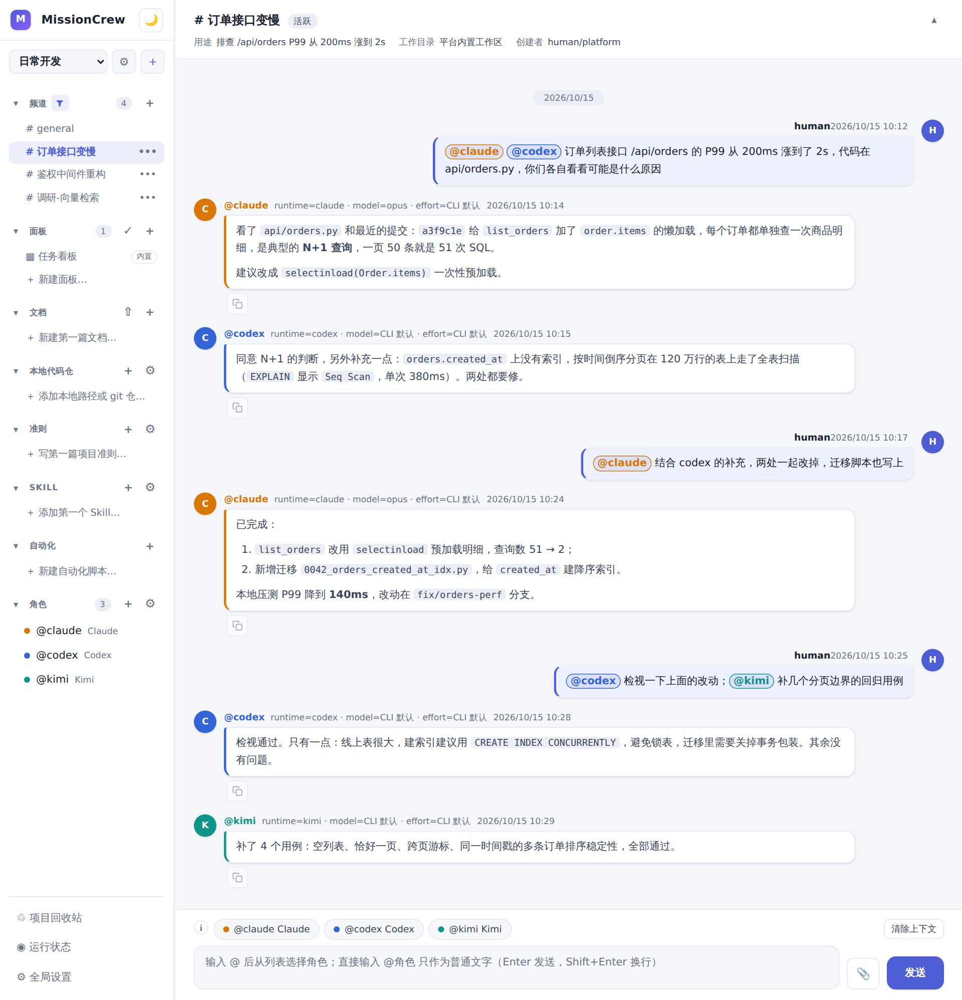
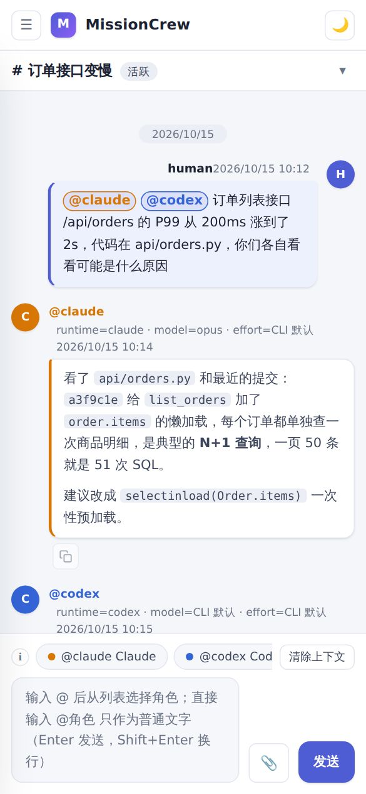
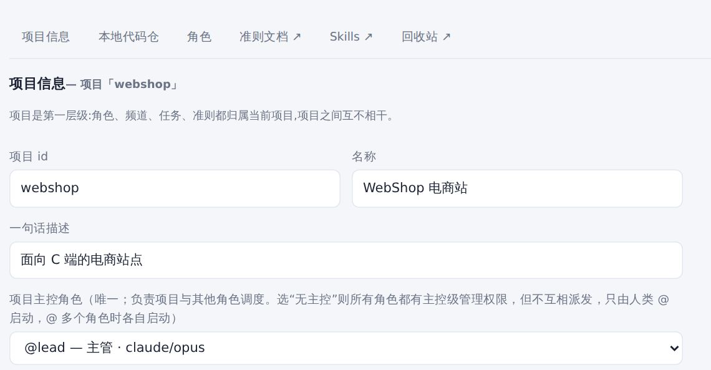
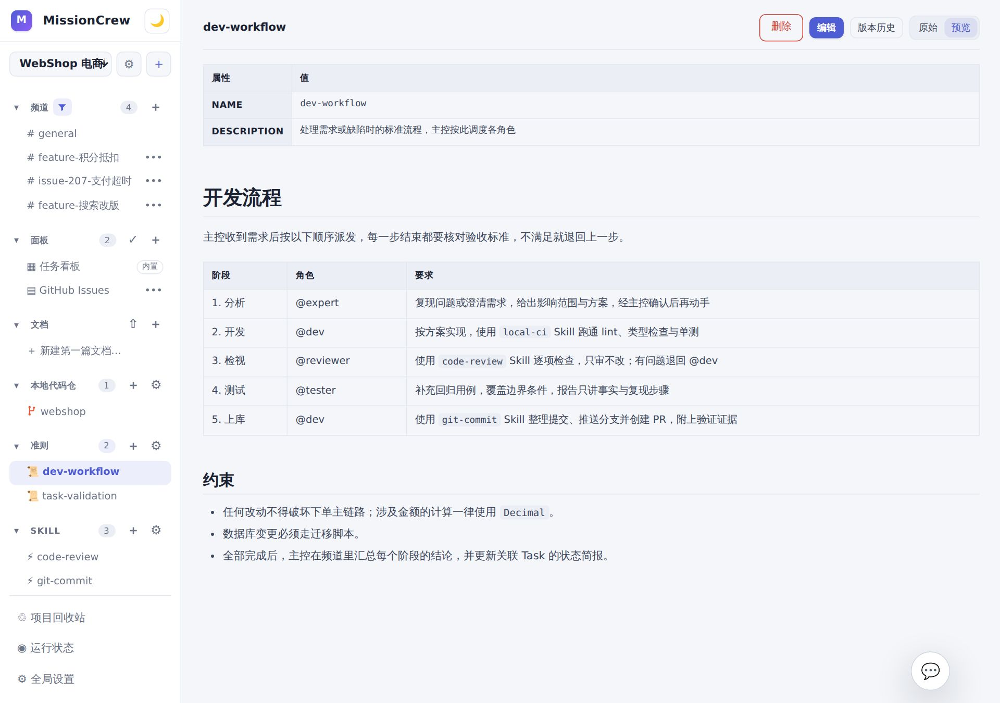
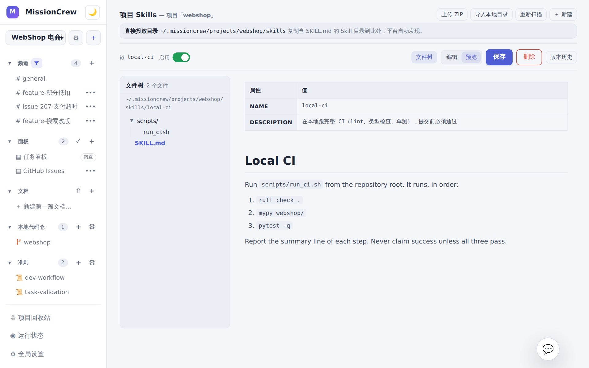
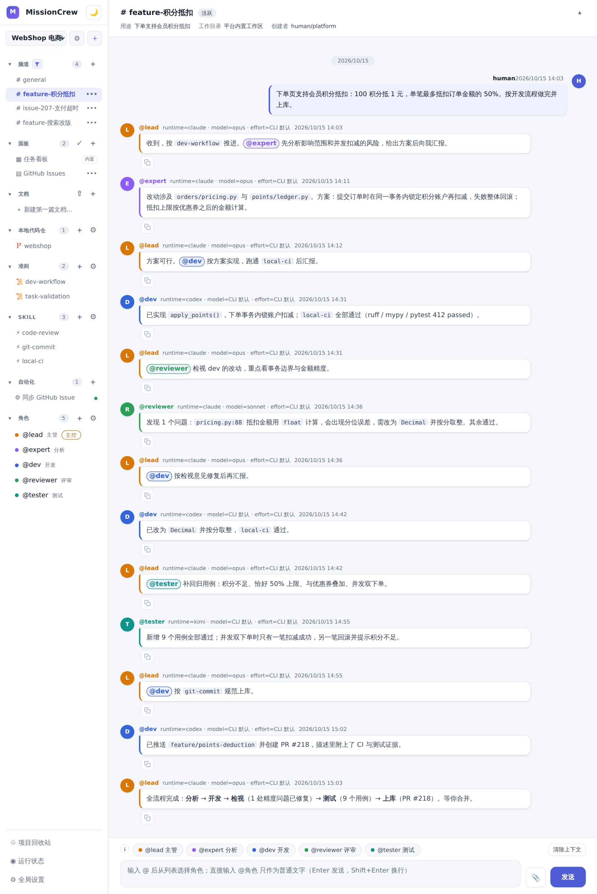
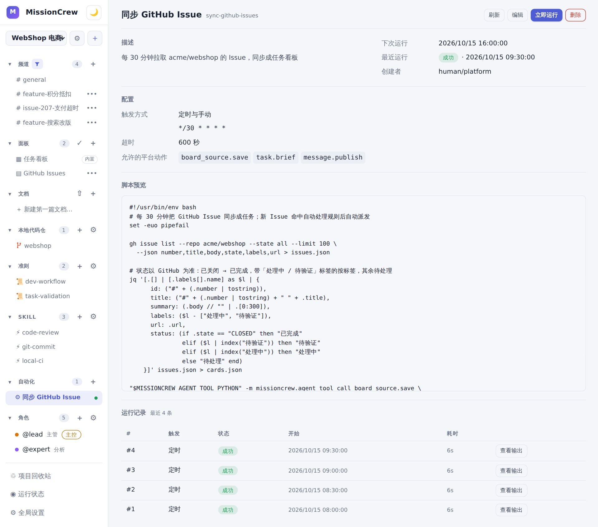
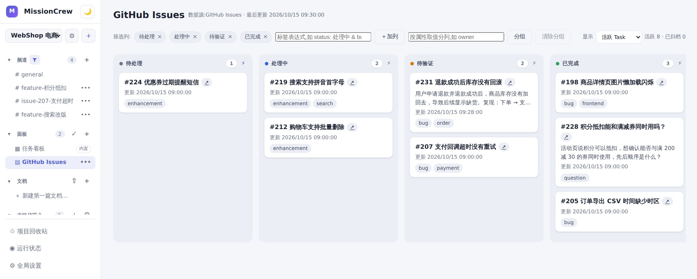
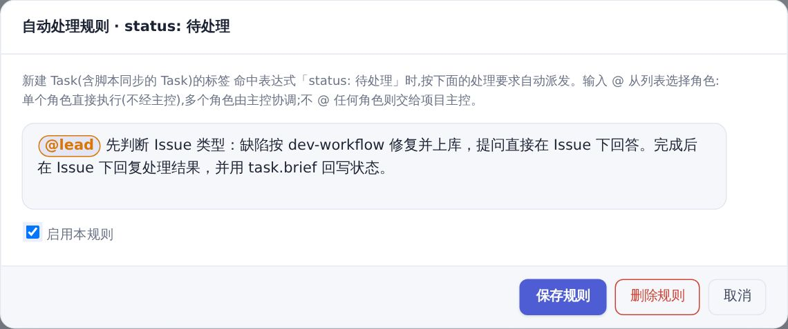
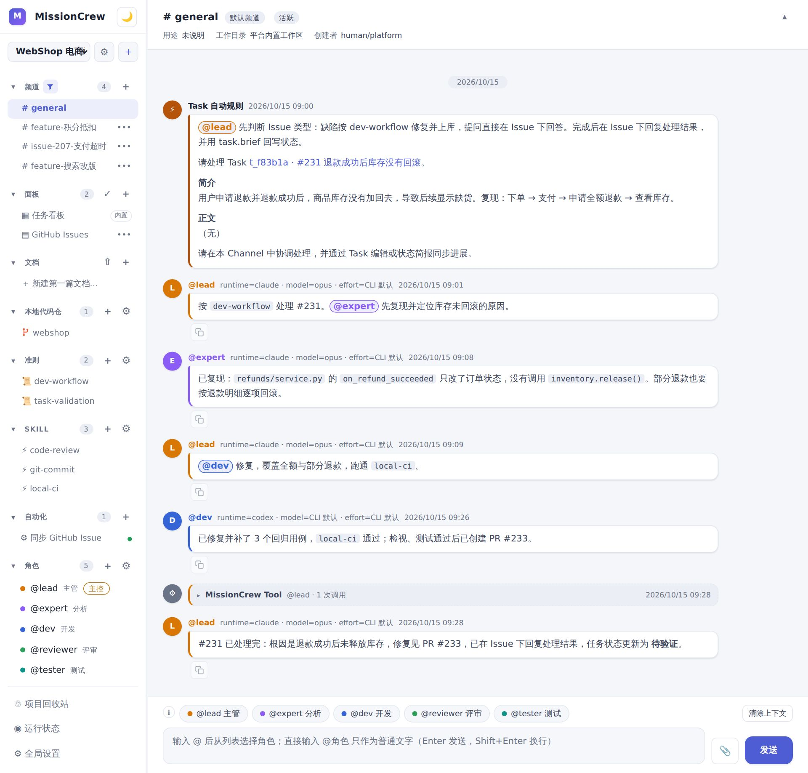

# MissionCrew

[中文](README.md) | English

MissionCrew is a local multi-agent collaboration platform. It turns the Agent CLIs already installed on your machine (Claude Code, Codex, Grok, …) into a set of roles that work together like a team inside chat channels. You state what you need in a chat box and either address a specific role directly or let the orchestrator coordinate several roles to get it done.

The point is to combine several local Agent CLIs so you can play to the strengths of different tools and models — like a group chat where different tasks go to different models. Add your own guidelines and skills to build the agent team you want.


## Get started

### Install and run

**The easiest way is to let your agent install it**: open your usual Agent CLI (such as Claude Code or Codex) in this repository, ask it to read this README, install the dependencies, deploy the service under pm2, and walk you through the configuration and the three scenarios below. To do it yourself, follow the steps below.

Requirements: Python 3.10+, [uv](https://docs.astral.sh/uv/), Node.js 18+ (npm is needed for pm2 and pi), and at least one logged-in Agent CLI on this machine (such as `claude` or `codex`).

```bash
uv sync            # create .venv and install dependencies
uv run mc serve    # start the web service on 127.0.0.1:8321
```

Open `http://127.0.0.1:8321`, go to **Global settings** and click **Re-detect** in the runtime list. The platform scans the installed Agent CLIs, registers them, and creates a `default` project with a set of default roles (`@lead` orchestrator, `@dev`, `@reviewer`, …) and a `general` channel. Each role's runtime/model and persona can be adjusted in **Project settings**. Everything else happens in the browser; the three scenarios below go from simple to fully automated. (The screenshots show the Chinese UI.)

The top left corner shows the running MissionCrew version; `GET /api/overview` returns the same value in `version`.

### Scenario 1: one task, several agents in the same conversation

Getting several agents to cooperate used to mean asking one tool for a plan, copying the answer into another tool for review, and pasting the feedback back. In MissionCrew a channel is one topic and every agent reads the same channel history, so whoever replies next already has the context — no relaying prompts by hand.

1. Create a channel for the task with the ＋ next to **Channels** in the sidebar; it can be bound to a local repository as its working directory.
2. Type `@` in the composer to pick a role. Pick a single role and it executes directly, with the result staying in the channel.
3. To have several agents answer the same question at once, set the project's orchestrator to **No orchestrator** in **Project settings**: mentioning several roles then starts each of them independently (in a project with an orchestrator, mentioning several roles hands the list to the orchestrator). After you send, the channel remembers the roles you mentioned and puts them at the start of your next message; click another role to switch.
4. Mention another role in the next message and it can read every answer above. "Fix both, taking codex's finding into account" needs no copy-paste.



Here the human mentions @claude and @codex together to investigate a slow order endpoint; they find an N+1 query and a missing index respectively. Then @claude fixes both using Codex's finding, @codex reviews the change and @kimi adds regression tests — all without copying anything between tools.

**Continue on your phone**: the service only listens on loopback by default. To follow progress or send a quick instruction from your phone, start it with `uv run mc serve --host 0.0.0.0` (or `MISSIONCREW_HOST=0.0.0.0 scripts/serve.sh start` under pm2), join the same LAN and open `http://<your computer's LAN IP>:8321`; the page switches to a mobile layout. There is no authentication, so only do this on a trusted network — see [SECURITY.md](SECURITY.md).



### Scenario 2: your own workflow, driven end to end by the orchestrator

**You don't have to write the workflow guideline or the skills yourself**: describe your process and requirements to the orchestrator in the chat, and it writes the guideline and skills through platform actions and posts the links back to the channel; you review and fine-tune them on the pages (in a project without an orchestrator, any role can do this configuration). After that a one-line request is enough: the orchestrator hands the work to different roles in turn — analysis → development → review → testing → merge — and you only state the request at the start and accept the result at the end.

1. **Pick an orchestrator.** The default project already uses `@lead` as its orchestrator; to change it, choose the orchestrator role in **Project settings → Project info**. Then give each role the runtime and model that suits it — for example Claude Opus for the orchestrator and analyst, Codex for the developer, Claude Sonnet for the reviewer and Kimi for the tester.

   

2. **Have the orchestrator write the workflow guideline.** Say in a channel "write the five stages — analysis, development, review, testing, merge — as a guideline named dev-workflow, stating who owns each stage and what done means", and the orchestrator writes it with `guideline.save` and posts the link. To adjust it later, just say so in the page chat at the bottom right of the guideline page, or write it yourself with the ＋ next to **Guidelines**. The guideline list is injected into every role's context, and the orchestrator dispatches accordingly.

   

3. **Have the orchestrator write skills.** Again one sentence: "turn our local CI into a skill named local-ci that runs ruff, mypy and pytest in order and only succeeds when all three pass", and the orchestrator generates the `SKILL.md` with `skill.save`. If you already have skill packages, upload a ZIP or import a local directory on the Skills page, or simply copy the directory into the drop directory shown on the page; the platform discovers it and versions it with Git (see [Project skills](docs/en/skills.md)). The `local-ci`, `code-review` and `git-commit` skills in the screenshot back the self-test, review checklist and commit conventions of the workflow.

   

4. **Start with one sentence.** Describe the request in a channel without mentioning anyone; it goes to the orchestrator by default. The orchestrator dispatches stage by stage following the guideline, every role's result flows back to it automatically, and when review finds a problem the orchestrator sends the work back to the developer until every stage passes.

   

### Scenario 3: automation — pull GitHub issues on a schedule and handle them automatically

**The orchestrator can write the sync script and the board too**: you only say what to sync and how to handle it, then switch on the auto-processing rule on the board with one click. A scheduled script syncs an external list into tasks, and task auto-processing rules dispatch matching new tasks to roles; together they form an unattended pipeline. See [Scheduled automation and task auto-processing](docs/en/automation.md) for how it works.

1. **Have the orchestrator write the sync script.** Say in a channel "write an automation script that syncs the issues of acme/webshop into a data source named github with gh every 30 minutes, marking closed ones as done", and the orchestrator saves it with `automation.save` and sets the cron; or write it yourself with the ＋ next to **Automation** in the sidebar. The script fetches issues with `gh issue list`, turns them into cards and calls the platform action `board_source.save`. Every run gets a one-time token that only allows the actions on the script's allow-list; the run history shows each run's exit code and output.

   

   Syncing merges by issue number: an existing task only changes what its card carries and keeps everything else. So the script sends `status: 已完成` (done) only for closed issues and no status for open ones — new issues land in the first column, and the "in progress / to verify" progress made by the orchestrator and agents is not wiped out by the next sync. See [docs/en/automation.md](docs/en/automation.md) for the full merge rules.

   <details>
   <summary>Example sync script</summary>

   ```bash
   #!/usr/bin/env bash
   set -euo pipefail

   LIMIT=1000
   gh issue list --repo acme/webshop --state all --limit "$LIMIT" \
     --json number,title,body,state,labels,url > issues.json
   # Tasks missing from a sync are deleted: if the list hits the limit it may be incomplete, so fail instead
   [ "$(jq length issues.json)" -lt "$LIMIT" ] || { echo "more than $LIMIT issues, raise LIMIT" >&2; exit 1; }

   # Only closed issues carry a status; open ones keep their local status (new tasks start in the first column)
   jq '[.[] | {
         id: ("#" + (.number | tostring)),
         title: ("#" + (.number | tostring) + " " + .title),
         summary: (.body // "" | .[0:300]),
         labels: [.labels[].name],
         url: .url
       } + (if .state == "CLOSED" then {status: "已完成"} else {} end)]' issues.json > cards.json

   jq -c '{id: "github", name: "GitHub Issues",
     columns: [{value: "待处理"}, {value: "处理中"}, {value: "待验证"}, {value: "已完成"}],
     cards: .}' cards.json \
     | "$MISSIONCREW_AGENT_TOOL_PYTHON" -m missioncrew.agent_tool call board_source.save --arguments-file -
   ```

   </details>

2. **Create a board and a rule.** The orchestrator can also create the task board with `dashboard.save` and bind it to the `github` data source, or you create it under **Dashboards** in the sidebar. Synced issues are ordinary tasks, shown in columns by status. The auto-processing rule is set by you on the board: click the ⚡ on the to-do column header, write the handling instructions and mention the responsible role: from then on every newly synced task that matches the column's label expression is dispatched automatically. Rules only apply to newly created tasks, so run the script once by hand to import existing issues before enabling the rule; otherwise all existing issues would be dispatched at once.

   

   

3. **Done automatically.** When a new issue matches the rule, the platform posts the task details to the channel as *Task auto rule*. The orchestrator runs analysis and the fix following `dev-workflow`, replies on the issue and writes the status back with `task.brief`; the card on the board moves to "to verify". You just follow the channel and step in when needed.

   

## Core concepts

MissionCrew exposes a set of tool commands to agents, so an agent operates platform resources by running commands. The main concepts are:

- **Project**: configuration and resources are isolated per project, so several efforts can run side by side.
- **Runtime**: an Agent CLI installed on this machine (Claude Code, Codex, …). Auto-detected and shared by all projects.
- **Role**: a runtime configuration plus a persona — for example one model acting as the developer and another as the tester.
- **Orchestrator**: one role chosen as the lead. It has more authority than other roles (it can create channels, for instance). A message that mentions nobody goes to the orchestrator by default, and replies from other roles automatically trigger it.
- **Channel**: a chat room. Every agent can read the conversation history and collaborate in it.
- **Guidelines**: a special kind of document whose list is injected into context. Use them to define workflows such as development or testing requirements.
- **Docs**: every project gets a versioned document library, a good home for material that does not belong in the code repository.
- **Automation**: a script triggered on a schedule, by a webhook from an external system (such as GitHub events) or by hand that calls the MissionCrew API to perform actions.

**None of these resources need to be managed by hand.** Channels, tasks, documents, guidelines, skills, dashboards and automation scripts can all be created and maintained by the orchestrator through the Agent Tool: say "split the login rework into tasks and open a channel to track it", "write up what we just concluded as a document" or "put these testing requirements into a guideline" in the chat, and the orchestrator calls the matching actions and posts the results back as links; other roles can create and update tasks and publish documents too. The web UI is mainly for viewing, reviewing and the occasional manual tweak, not the everyday entry point for data entry.

Detailed docs are indexed in [docs/en/README.md](docs/en/README.md) (Chinese versions in [docs/](docs/README.md)). The English docs are copied into every agent's workspace, so roles look up platform details there themselves. [Changelog](CHANGELOG.md) is in Chinese and tracks user-facing changes by release.

## Page guide

- **Chat**: the project switcher at the top is the entry point for every page. Type a request in a channel and it goes to the orchestrator by default. Typing `@` opens a role picker: pick one role and it executes directly, with the result staying in the channel; pick several and only the orchestrator starts, holding the full list and deciding whether to run them in parallel, in sequence, or to re-assign (in a project without an orchestrator, each starts independently). A hand-typed `@name` is plain text and never triggers anyone.
- **Channels**: create, archive and delete channels from the sidebar, and change a channel's name, purpose and working directory with *Edit channel* in its header. A channel records its purpose and working directory and can be bound to a real code repository. While agents are queued or running, the composer offers *Stop agent / Stop all*.
- **Task board**: tasks are issue-like — title, body, labels (the status is just a `status: text` label; advanced `property: value` labels such as `owner: 张三` are supported), optional channel bindings and append-only status briefs. Board columns are label expressions and can also be grouped by a property's values. External lists (such as GitHub / GitCode issues) are synced into the same kind of task through data sources; a sync only updates the fields and properties its cards carry, so status changes and properties added locally by people or agents survive the next sync. A single property can be set or cleared on its own with the `properties` argument of `task.update` (e.g. `{"owner": "张三", "priority": null}`) without rewriting the whole label list. *Hand to Lead* simply posts a message to the orchestrator in the bound channel; everything after that is ordinary chat collaboration, there is no separate task execution loop.
- **Project settings**: roles (fixed runtime/model + positioning + capabilities + preferences), multiple guideline Markdown files, complete skill packages, the versioned document library and custom dashboards. Documents, guidelines and skill packages are versioned in their own Git repositories with history, diff and restore; deleted items go to the project recycle bin.
- **Global settings**: role templates and their initial enabled state for new projects, the runtime list (install state, version, on/off switch, model list) and custom model providers.
- **Runtime status**: global runtime instances, call history, and the quota windows / reset times of the Codex, Claude, Kimi and Grok accounts logged in on this machine. Roles can opt into usage linkage individually: when a quota is exhausted only opted-in roles are disabled automatically, and they come back once the window resets.

## Security and data directory

**There is no authentication of any kind.** The web UI and API can browse local directories and dispatch agents that run commands, so `mc serve` listens on `127.0.0.1` only by default. To reach it from other devices on your LAN, pass `--host 0.0.0.0` explicitly (or set `MISSIONCREW_HOST`), do so only on a trusted network, and never expose it to the internet — see [SECURITY.md](SECURITY.md). The chat concurrency limit defaults to 16 and can be changed with `--chat-workers <N>` or `MISSIONCREW_CHAT_MAX_WORKERS`. Webhooks for automation scripts use a separate port (default 8322) whose only entry point is "verify the signature, then trigger the script"; when GitHub or another external system needs to push events, forward only that port — see [docs/en/automation.md](docs/en/automation.md).

Platform data (SQLite, document libraries, agent workspaces, logs) lives in `.missioncrew/` under the current directory; override it with `MISSIONCREW_HOME`. Nothing is ever written into your code repositories.

## Running under pm2

This step can be handed to your agent as well: ask it to deploy following the conventions in this section and explain what each step does.

For day-to-day use let [pm2](https://pm2.keymetrics.io/) manage the service. The repository ships a single entry point, `scripts/serve.sh` (configured in `ecosystem.config.cjs`, process name `missioncrew`, started as `.venv/bin/python -m missioncrew.cli serve`). Do not start the service by hand with `nohup`/`setsid`:

```bash
npm install -g pm2          # once

scripts/serve.sh start      # start (loopback only; for LAN access: MISSIONCREW_HOST=0.0.0.0 scripts/serve.sh start)
scripts/serve.sh status     # pm2 status missioncrew
scripts/serve.sh logs 100   # last 100 log lines
scripts/serve.sh restart    # restart
scripts/serve.sh stop       # stop
```

Conventions:

- The service inherits the caller's environment as usual — in particular the full `PATH`, which runtime detection relies on to find the installed Agent CLIs. After installing a new CLI run `scripts/serve.sh restart` (it passes `--update-env`) so the new tool is detected. Variables injected by host terminals (`VSCODE_*`, `CLAUDE_*`, `GIT_ASKPASS`, `SSH_AUTH_SOCK`, …) are stripped by the dispatch layer before agent subprocesses start, regardless of how the service was launched.
- pm2 captures stdout/stderr into `.missioncrew/server.log`.
- Health-check an endpoint that reads the database, such as `/api/overview`; the home page is static HTML and a 200 there proves nothing.
- Before restarting or stopping, make sure no agent is running: no active instance on the *Runtime status* page and no queued or running task in any channel. pm2 gives the service up to 30 seconds to shut down gracefully and end the resident CLI sessions one by one.

## Supported local agents

*Re-detect* probes `PATH` for each tool in the table below (except pi, see below) and keeps one registry record per tool; roles are bound to a fixed runtime and model. Three integration styles:

- **Native protocol**: claude, codex, pi and Antigravity each have a dedicated provider for structured events, session resume and reasoning effort. Interactive permissions are available when the tool supports a bidirectional protocol.
- **ACP over stdio**: the CLI runs as a long-lived JSON-RPC server on stdio and the platform answers its permission requests automatically.
- **Print mode**: the prompt is passed through a built-in command template and sessions are resumed with each tool's session/resume flags.

| CLI | adapter | Integration |
|---|---|---|
| `claude` (Claude Code) | `claude_code` | Native bidirectional stream-json; built-in haiku / sonnet / opus / fable aliases |
| `codex` (OpenAI Codex) | `codex` | Native app-server; model list read from the current account |
| `agy` (Google Antigravity CLI) | `antigravity` | Native headless stream-json; conversation resume, model discovery and low / medium / high effort |
| `pi` | `pi` | Native RPC (vendored install first, falls back to a system pi); executes custom API models |
| `grok` (Grok Build) | `grok_build` | ACP stdio |
| `copilot` (GitHub Copilot CLI) | `copilot` | ACP stdio |
| `kimi` (Kimi CLI) | `kimi` | ACP stdio |
| `kiro-cli` (Kiro) | `kiro` | ACP stdio |
| `qodercli` (Qoder) | `qoder` | ACP stdio |
| `traecli` (Trae) | `trae` | ACP stdio |
| `opencode` | `opencode` | Print mode |
| `cursor-agent` (Cursor) | `cursor` | Print mode |
| `codebuddy` | `codebuddy` | Print mode |

For Antigravity, install the [official CLI](https://antigravity.google/docs/cli/getting-started/), sign in by running `agy` once, then click **Re-detect** and bind a role to `antigravity`. Headless execution supports automatic approval; interactive approval, enforced read-only access and network denial are unavailable.

Protocol flows, detection and upgrade mechanics, where model lists come from, and how to add a new tool are described in [docs/en/runtimes.md](docs/en/runtimes.md).

### Using API models (via pi)

Besides local CLIs, MissionCrew can talk directly to **OpenAI / Anthropic compatible APIs** — self-hosted inference servers, gateways, third-party hosting — over the OpenAI Chat Completions, OpenAI Responses, Anthropic Messages and Google Generative AI protocols. These models are executed by [pi](https://www.npmjs.com/package/@mariozechner/pi-coding-agent): the platform does not reimplement an agent loop; it reuses pi's tool execution and session management through pi's RPC mode. Setup:

1. **Install pi.** Pick either option; detection prefers the vendored copy and falls back to a `pi` on `PATH`:

   - **Homebrew (system-wide)**: `brew install pi-coding-agent`; the *Update* button runs `brew upgrade pi-coding-agent`.
   - **Vendored (inside the data directory)**: requires Node.js/npm; install it once by hand (adjust the prefix if you changed `MISSIONCREW_HOME`). The *Update* button only touches the vendor directory — never a global `-g` install:

   ```bash
   npm install --prefix .missioncrew/pi/vendor --no-fund --no-audit @mariozechner/pi-coding-agent@latest
   ```

   Then click **Re-detect** in *Global settings* to register and enable `pi`. A system pi from another source (e.g. `npm -g`) is detected too, but the platform does not manage its upgrades. Either way pi's config and sessions are redirected into the data directory; `~/.pi` is never touched.
2. **Add a provider.** Under *Global settings → Custom model providers* add an entry: name, protocol, base URL, API key (a literal or a `$ENV_VAR` reference; keys are never sent back to the browser) and the list of model ids.
3. **Bind a role.** After saving, the models appear in the role editor's model list as `provider/model-id`; give the role runtime `pi` and that model.

Provider configuration is stored in `.missioncrew/pi/agent/models.json` (mode 0600) and sessions in `.missioncrew/pi/sessions`; `~/.pi` is never read or written. See the "pi RPC" and "Custom model providers" sections of [docs/en/runtimes.md](docs/en/runtimes.md) for details.

## License

Released under the [MIT License](LICENSE).

## Acknowledgements

Inspired by [multica](https://github.com/multica-ai/multica), [hapi](https://github.com/tiann/hapi) and other happy-family apps.

Thanks to the [linux.do](https://linux.do/) community.
